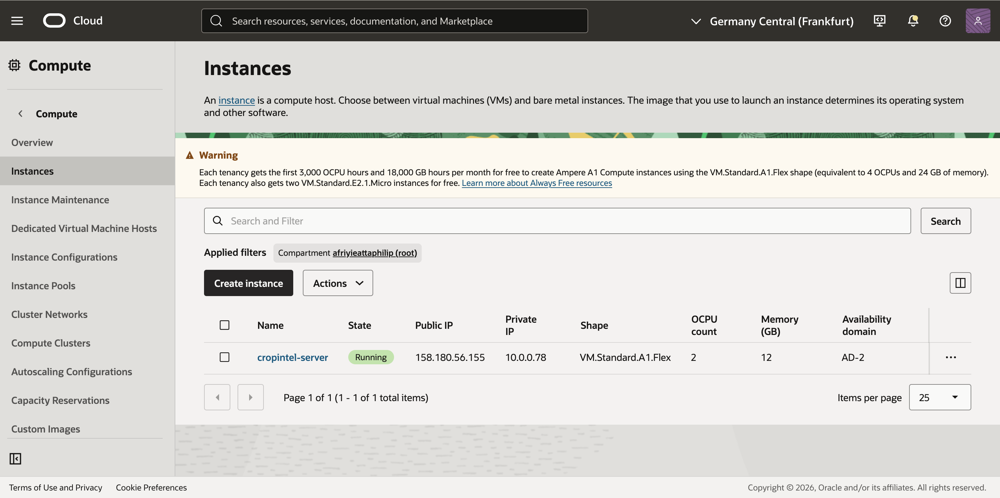
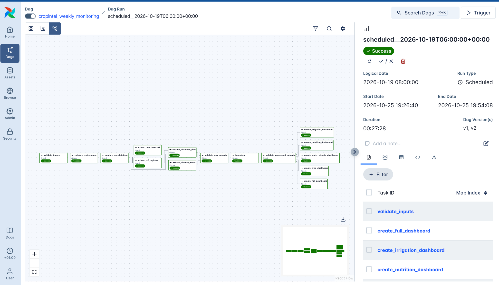
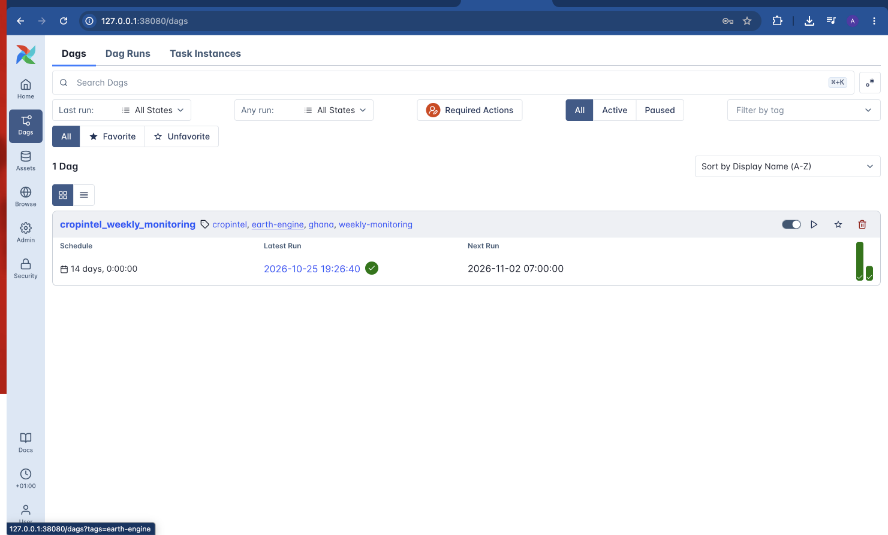
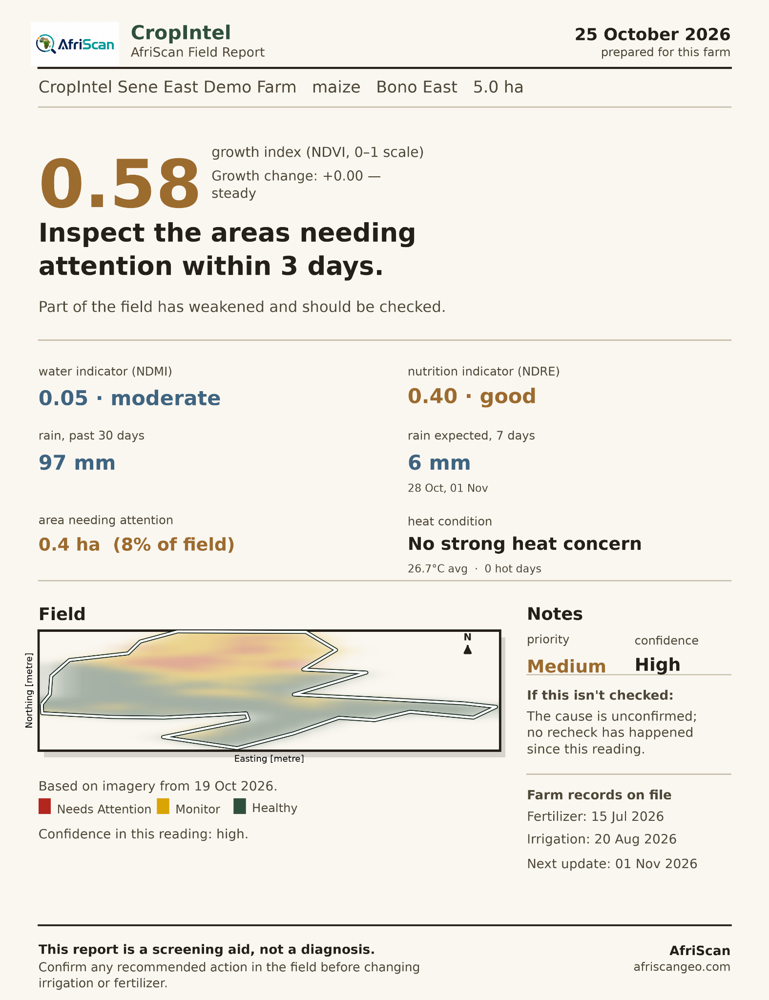
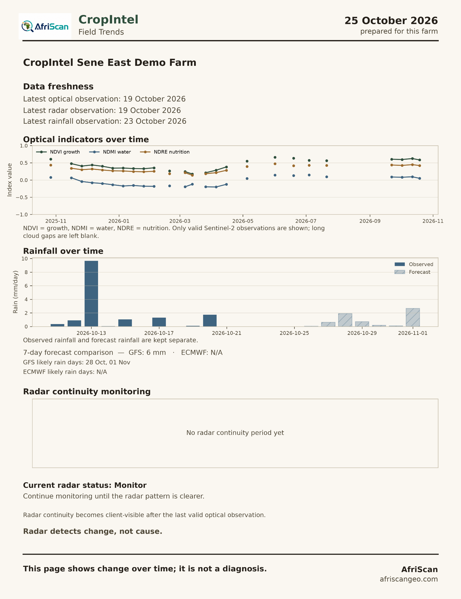
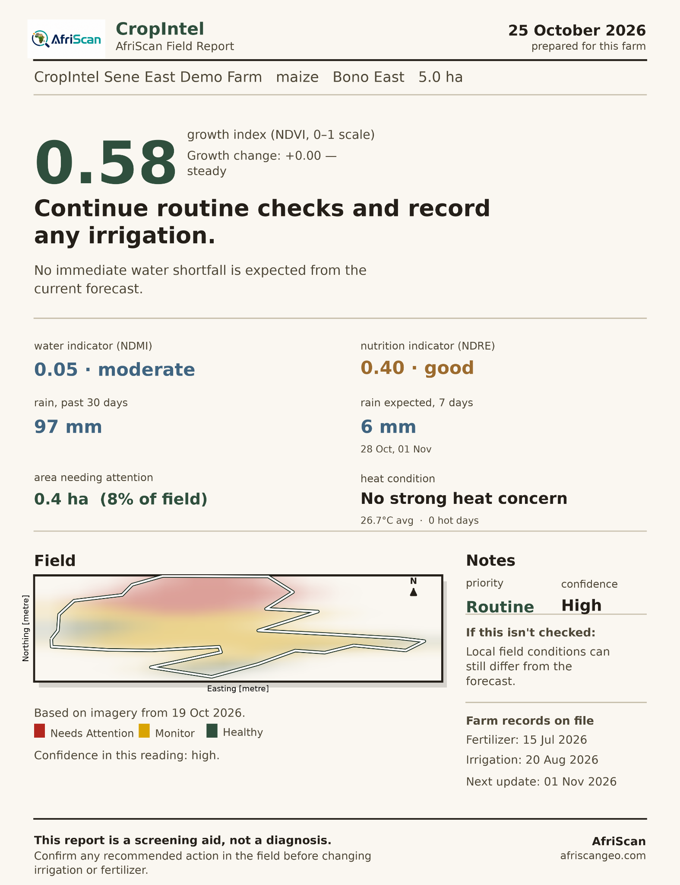
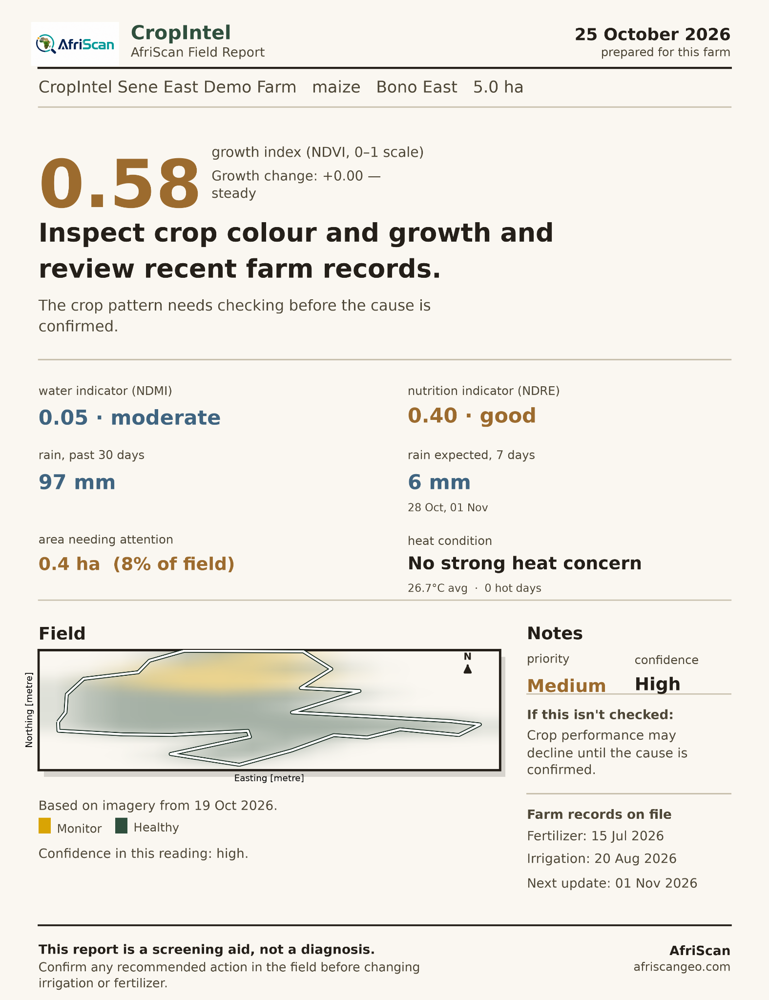
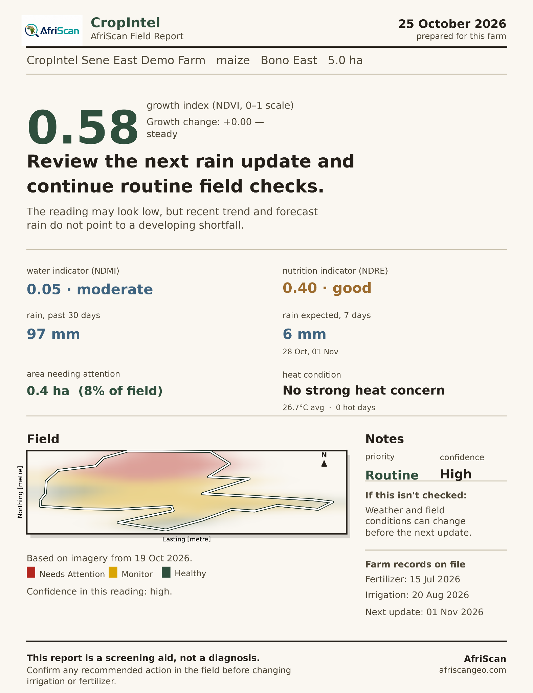

# CropIntel

### Cloud-Based Satellite Farm Monitoring Platform

**An AfriScan Geospatial Software Project**

CropIntel is a Python-based agricultural monitoring platform developed to support satellite-based crop monitoring, environmental assessment, and farm-level decision-making.

The platform integrates satellite imagery, weather observations, rainfall forecasts, geospatial analysis, and automated processing workflows to produce farm-specific monitoring reports.

CropIntel is designed to help agricultural businesses, farmer cooperatives, and farm managers identify areas requiring field inspection and monitor changes in crop conditions over time.

**Developer** - Philip Atta Afriyie  
**Project** - CropIntel  
**Organization** - AfriScan  
**Website** - https://afriscangeo.com  
**Application Area** - Precision Agriculture, Remote Sensing and Geospatial Software Engineering  
**Project Status** - Prototype development and testing  

---

## 1. Project Overview

CropIntel combines satellite Earth observation with automated geospatial processing to monitor agricultural fields.

The platform uses Sentinel-1 radar observations, Sentinel-2 multispectral imagery, climate data, and rainfall forecasts to generate monitoring information for multiple farms.

### Main capabilities

- Satellite-based vegetation monitoring
- NDVI growth and vegetation condition assessment
- NDMI water-related vegetation monitoring
- NDRE vegetation and red-edge monitoring
- Historical rainfall analysis
- Seven-day rainfall forecasting
- Environmental and temperature monitoring
- Farm-boundary processing using GeoJSON
- Identification of areas requiring field inspection
- Farm-level spatial visualization
- Automated monitoring report generation
- Temporal analysis of satellite indicators
- Scheduled processing using Apache Airflow
- Cloud-based deployment using Oracle Cloud Infrastructure

The system is intended to support field inspection and agricultural decision-making rather than replace direct agronomic assessment.

---

## 2. Technology Stack

| Component | Technology |
|---|---|
| Programming Language | Python |
| Satellite Data | Sentinel-1 SAR, Sentinel-2 |
| Satellite Processing | Google Earth Engine |
| Climate Data | ERA5-Land |
| Rainfall Data | Satellite rainfall observations and weather forecasts |
| Geospatial Data | Raster datasets, GeoJSON, farm boundaries |
| Geospatial Analysis | Vegetation indices and spatial processing |
| Cloud Infrastructure | Oracle Cloud Infrastructure |
| Cloud Region | Frankfurt, Germany |
| Operating System | Ubuntu 24.04 ARM64 |
| Containerization | Docker and Docker Compose |
| Workflow Orchestration | Apache Airflow |
| Database | PostgreSQL |
| Visualization | Python-based maps and farm reports |

---

## 3. Oracle Cloud Infrastructure Deployment

CropIntel has been deployed to an Oracle Cloud Infrastructure virtual machine running Ubuntu Linux.

The cloud environment hosts the containerized Apache Airflow services, PostgreSQL database, and Python processing workflows.

This deployment allows CropIntel to execute scheduled monitoring tasks without requiring the developer's personal computer to remain switched on.

### Cloud server configuration

| Resource | Configuration |
|---|---|
| Cloud Provider | Oracle Cloud Infrastructure |
| Region | Germany Central, Frankfurt |
| Instance Name | cropintel-server |
| Instance Shape | VM.Standard.A1.Flex |
| CPU | 2 OCPUs |
| Memory | 12 GB |
| Operating System | Ubuntu 24.04 ARM64 |
| Workflow Management | Apache Airflow |
| Container Management | Docker Compose |
| Database | PostgreSQL |

### Oracle Cloud Running Instance

The following screenshot shows the CropIntel virtual machine running on Oracle Cloud Infrastructure.



The instance provides cloud computing resources for satellite processing, automated workflows, and report generation.

The deployment uses SSH-based access for server administration and access to the Airflow interface.

---

## 4. Automated Workflow Using Apache Airflow

CropIntel uses Apache Airflow to manage the execution of its geospatial processing pipeline.

The workflow coordinates the stages required to process farm information, extract satellite and environmental observations, transform the results, and generate monitoring reports.

### Processing stages

1. Validate farm input datasets.
2. Validate the processing environment.
3. Record the processing date.
4. Extract Sentinel-2 satellite observations.
5. Extract regional satellite datasets.
6. Retrieve rainfall forecasts.
7. Retrieve observed climate and water-related data.
8. Validate raw outputs.
9. Transform and analyze extracted data.
10. Validate processed outputs.
11. Generate farm-specific crop reports.
12. Generate irrigation reports.
13. Generate nutrition-related monitoring reports.
14. Generate water and climate reports.
15. Generate full farm monitoring reports.

### Successful Airflow Pipeline Execution

The screenshot below shows a successful execution of the CropIntel monitoring pipeline.



The demonstrated workflow completed successfully on **25 October 2026**.

**Execution summary**

| Metric | Result |
|---|---|
| Execution Date | 25 October 2026 |
| Execution Status | Success |
| Processing Duration | 27 minutes and 28 seconds |
| Workflow Platform | Apache Airflow |
| Cloud Platform | Oracle Cloud Infrastructure |

The successful DAG execution demonstrates that the configured processing tasks completed without a reported Airflow task failure during that run.

### Scheduled Workflow Execution

CropIntel also supports scheduled execution through Apache Airflow.



The screenshot shows a monitoring interval of **14 days**.

The DAG identifier remains:

`cropintel_weekly_monitoring`

The included DAG file is an earlier source snapshot with a weekly schedule, while the deployment screenshot shows the later 14-day configuration.

---

## 5. Demonstration Farm

CropIntel has generated monitoring reports for a demonstration maize farm in Ghana.

The reports presented in this repository were produced from the platform's processing and reporting workflows.

| Farm Attribute | Information |
|---|---|
| Farm Name | CropIntel Sene East Demo Farm |
| Region | Bono East, Ghana |
| Crop | Maize |
| Farm Area | 5.0 hectares |
| Report Date | 25 October 2026 |
| Latest Optical Observation | 19 October 2026 |
| Latest Radar Observation | 19 October 2026 |
| Latest Rainfall Observation | 23 October 2026 |

The images below are examples of actual CropIntel-generated outputs.

These reports represent software demonstration results and should not be interpreted as independently validated agronomic diagnoses.

---

## 6. Farm Monitoring Outputs

### 6.1. Full Farm Monitoring Report

The full monitoring report combines vegetation indicators, rainfall information, environmental conditions, and spatial maps in a single farm-specific report.


The demonstrated report contains the following indicators.

| Indicator | Reported Value |
|---|---|
| NDVI | 0.58 |
| NDMI | 0.05 |
| NDRE | 0.40 |
| Rainfall During Previous 30 Days | 97 mm |
| Forecast Rainfall for Next 7 Days | 6 mm |
| Area Requiring Attention | 0.4 ha |
| Share of Farm Requiring Attention | 8% |
| Average Temperature | 26.7°C |

The report identifies areas that may require additional field observations.

### 6.2. Crop Condition Monitoring

CropIntel generates crop condition reports based on satellite-derived vegetation indicators and spatial monitoring results.



The report presents vegetation condition, inspection priorities, and areas where crop changes should be investigated.

Satellite-derived changes are treated as indicators requiring verification rather than confirmed evidence of crop damage or disease.

### 6.3. Temporal Monitoring and Field Trends

CropIntel tracks changes in vegetation indicators and rainfall conditions over time.



The trend report includes:

- NDVI observations over time
- NDMI observations over time
- NDRE observations over time
- Historical rainfall
- Forecast rainfall
- Optical satellite data freshness
- Radar observation dates
- Radar continuity monitoring status

The monitoring process distinguishes available satellite observations from missing observations.

### 6.4. Irrigation Monitoring

The irrigation monitoring report combines vegetation moisture indicators and weather-related information.



The report supports field inspection and the review of irrigation management conditions.

NDMI is used as a vegetation moisture-related indicator and does not directly measure soil moisture or irrigation requirements.

### 6.5. Nutrition-Related Monitoring

The nutrition monitoring report uses vegetation indicators to assess changes potentially relevant to crop performance.



The report incorporates NDRE and available agricultural management records to support the review of crop conditions.

NDRE does not independently confirm nutrient deficiency or determine fertilizer requirements.

### 6.6. Water and Climate Monitoring

CropIntel combines satellite-derived moisture-related indicators with rainfall and temperature information.



The report provides environmental context and supports monitoring of potential changes affecting agricultural production.

---

## 7. Selected Python Source Files

This repository contains selected original Python scripts used in the CropIntel development workflow.

These scripts demonstrate satellite processing, geospatial data handling, vegetation time-series analysis, validation, and visualization.

| Python File | Function |
|---|---|
| `extract_data.py` | Satellite data extraction and geospatial processing |
| `gap_fill_ndvi.py` | NDVI time-series processing and missing observation handling |
| `gee_helpers.py` | Google Earth Engine helper functions |
| `farm_loader.py` | Farm boundary loading and validation |
| `transform_data.py` | Processing and transformation of extracted data |
| `validate_outputs.py` | Validation of generated processing outputs |
| `dashboard_maps.py` | Geospatial mapping and report visualization |
| `cropintel_monitoring_dag.py` | Apache Airflow pipeline orchestration |

The source files are selected from the actual CropIntel project.

They are not intended to represent a complete stand-alone application. The full system depends on additional private modules, configuration files, datasets, and operational infrastructure.

---

## 8. Repository Structure

```text
CropIntel_Cloud-Based_Satellite_Farm_Monitoring_Platform/
│
├── README.md
├── LICENSE
├── PUBLICATION_NOTES.md
│
├── dags/
│   └── cropintel_monitoring_dag.py
│
├── src/
│   ├── extract_data.py
│   ├── gap_fill_ndvi.py
│   ├── gee_helpers.py
│   ├── farm_loader.py
│   ├── transform_data.py
│   ├── validate_outputs.py
│   └── dashboard_maps.py
│
└── docs/
    │
    ├── airflow/
    │   ├── cropintel-running-instance.png
    │   ├── successful-dag-run.png
    │   └── schedule-dashboard.png
    │
    └── sample-reports/
        ├── overview.png
        ├── crop-condition.png
        ├── field-trends.png
        ├── irrigation.png
        ├── nutrition.png
        └── water-and-climate.png
```

---

## 9. Satellite Indicators

### Normalized Difference Vegetation Index

NDVI is calculated using red and near-infrared reflectance.

It is commonly used to assess vegetation greenness and monitor changes in canopy conditions.

### Normalized Difference Moisture Index

NDMI uses near-infrared and shortwave-infrared reflectance.

It provides information associated with vegetation water content.

### Normalized Difference Red Edge Index

NDRE uses red-edge and near-infrared reflectance.

It supports monitoring of vegetation characteristics associated with chlorophyll variation and crop development.

### Sentinel-1 Radar Monitoring

Sentinel-1 SAR provides radar observations that can complement optical monitoring when clouds limit usable satellite imagery.

Radar backscatter responds to several properties, including vegetation structure, surface moisture, and observation geometry.

CropIntel uses radar information to support continuity monitoring.

Changes detected through radar are not independently interpreted as confirmed causes of crop stress.

---

## 10. Data Validation and Quality Assurance

CropIntel includes processing stages for validating inputs and outputs.

These stages are used to identify problems before or after satellite data processing.

Examples include:

- Farm boundary validation
- Input dataset checks
- Environment validation
- Raw data output validation
- Processed output validation
- Monitoring of workflow execution
- Identification of missing satellite observations

Apache Airflow provides execution status information that supports monitoring and troubleshooting of pipeline tasks.

A successful workflow execution confirms task completion but does not independently establish the scientific accuracy of the generated agricultural indicators.

---

## 11. Current Limitations

CropIntel remains under development and evaluation.

Important limitations include:

- Optical imagery may be unavailable during periods of cloud cover.
- Satellite observation dates may differ from report generation dates.
- Vegetation indices cannot independently diagnose pests, disease, or nutrient deficiencies.
- Radar backscatter changes may have multiple causes.
- Farm management history affects interpretation.
- Crop growth stages affect spectral measurements.
- Satellite-based monitoring requires appropriate spatial and temporal validation.
- Field observations are needed to confirm reported conditions.
- Demonstration results do not establish operational accuracy across all crops and regions.
- The selected public scripts do not include every dependency required to execute the full application.

The monitoring reports are designed to assist field assessment rather than replace it.

---

## 12. Development Priorities

Current development priorities include:

- Validation of monitoring indicators against field observations
- Additional farm-level pilot testing
- Assessment of processing reliability across multiple farms
- Improvement of satellite observation continuity
- Evaluation of spatial monitoring accuracy
- Expansion of automated reporting
- Improvement of workflow monitoring and error handling
- Development of services for agricultural companies and farmer cooperatives

These are development objectives and are not presented as completed capabilities.

---

## 13. Project Development and Commercial Scope

CropIntel is being developed as a geospatial agricultural monitoring platform under AfriScan.

This repository serves as a technical portfolio demonstrating selected programming, remote sensing, workflow automation, and cloud deployment capabilities.

The complete production system, confidential customer data, private configuration files, and commercially sensitive components are not included.

Commercial deployment remains subject to applicable cloud service agreements, satellite data licensing, privacy obligations, and other relevant requirements.

---

## 14. Developer

**Philip Atta Afriyie**

Geospatial Software Engineering | Remote Sensing | Agricultural Data Science

**Project** - CropIntel  
**Organization** - AfriScan  
**Website** - https://afriscangeo.com

---

## Disclaimer

CropIntel provides satellite-derived monitoring information for agricultural field assessment.

The reports are screening tools and do not provide definitive diagnoses of crop diseases, nutrient deficiencies, or irrigation requirements.

All recommended management actions should be confirmed using field observations and appropriate agronomic assessment.
